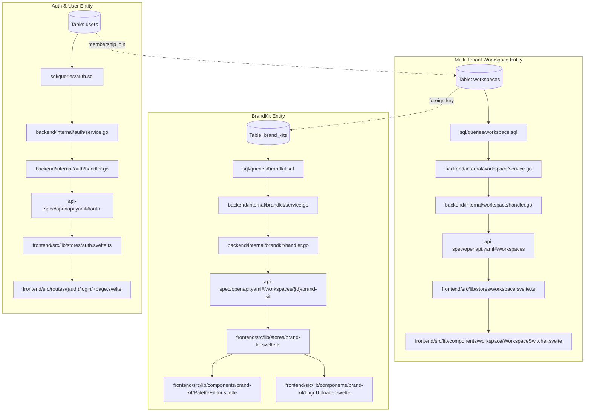

# DOC-003: Architectural Knowledge Graph (Graphify Registry)

```yaml
id: DOC-003
type: Knowledge-Graph-Registry
status: Active
domain: System Topology & Dependency Graph
revision: 1.0
last_updated: 2026-11-24
dependencies: [DOC-001, DOC-002]
```

---

## 1. Graph Traversal Guide for AI Agents

When implementing or modifying any feature, do **NOT** read random files. Traverse the graph below:
1. Locate the **Entity Node** corresponding to your task.
2. Follow the downstream edges to find the exact database table, SQL query, Go service, OpenAPI contract, and Svelte store.
3. Only open the target files along that path.

---

## 2. Topological Entity Graph



---

## 3. Node & Edge Registry (Machine-Readable Map)

### Node: `Entity.Workspace`
* **Invariants:** [DOC-002 § 1](file:///Users/manoranjan/Projects/Learning/digital-marketing-assistant/docs/architecture_decisions.md#1-system-invariants-non-negotiable-rules) (Must enforce `workspace_id` tenant isolation)
* **Schema Definition:** `sql/schema/001_initial_schema.sql` (`workspaces`, `workspace_members`)
* **Persistence Query:** `sql/queries/workspace.sql`
* **Backend Domain:** `backend/internal/workspace/` (`service.go`, `handler.go`, `repository.go`)
* **API Endpoint:** `api-spec/openapi.yaml` (`/api/v1/workspaces`, `/api/v1/workspaces/{id}/switch`)
* **Frontend Store:** `frontend/src/lib/stores/workspace.svelte.ts`
* **Consumer Widgets:** `frontend/src/lib/components/workspace/WorkspaceSwitcher.svelte`

### Node: `Entity.BrandKit`
* **Invariants:** [DOC-002 § 1 & § 2](file:///Users/manoranjan/Projects/Learning/digital-marketing-assistant/docs/architecture_decisions.md#1-system-invariants-non-negotiable-rules) (Widgets MUST NOT call fetch; use `brandKitStore`)
* **Schema Definition:** `sql/schema/001_initial_schema.sql` (`brand_kits`)
* **Persistence Query:** `sql/queries/brandkit.sql`
* **Backend Domain:** `backend/internal/brandkit/` (`service.go`, `handler.go`, `repository.go`)
* **API Endpoint:** `api-spec/openapi.yaml` (`/api/v1/workspaces/{id}/brand-kit`)
* **Frontend Store:** `frontend/src/lib/stores/brand-kit.svelte.ts`
* **Consumer Widgets:**
  - `frontend/src/lib/components/brand-kit/PaletteEditor.svelte`
  - `frontend/src/lib/components/brand-kit/LogoUploader.svelte`
  - `frontend/src/lib/components/brand-kit/VoiceSelector.svelte`

### Node: `Entity.Auth`
* **Invariants:** Stateless JWT tokens; passwords hashed with bcrypt; token contains `user_id`.
* **Schema Definition:** `sql/schema/001_initial_schema.sql` (`users`)
* **Persistence Query:** `sql/queries/auth.sql`
* **Backend Domain:** `backend/internal/auth/` (`service.go`, `handler.go`, `repository.go`)
* **API Endpoint:** `api-spec/openapi.yaml` (`/api/v1/auth/register`, `/api/v1/auth/login`)
* **Frontend Store:** `frontend/src/lib/stores/auth.svelte.ts`
* **Consumer Routes:** `frontend/src/routes/(auth)/login/+page.svelte`, `frontend/src/routes/(auth)/register/+page.svelte`
