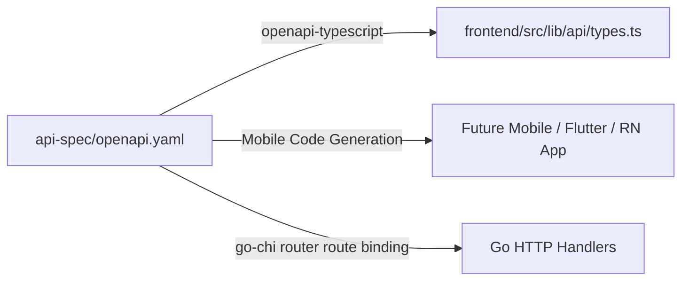

# DOC-002: System Architecture, State Segregation & Persistence Specification

```yaml
id: DOC-002
type: Architecture-Specification
status: Accepted
domain: Core System Design & Implementation Standards
revision: 1.2
last_updated: 2026-11-24
dependencies: [DOC-001]
```

---

## 1. System Invariants (Non-Negotiable Rules)

1. **Strict UI-Logic Decoupling:** Svelte components MUST NOT perform direct `fetch` calls or maintain complex mutation logic. All mutations and network calls MUST reside in `.svelte.ts` store modules.
2. **Compile-Time Persistence:** Raw SQL strings MUST NOT be concatenated inside Go application code. All queries MUST be defined in `.sql` files and compiled into type-safe Go via `sqlc`.
3. **Explicit Dependency Injection:** Services and Handlers MUST receive dependencies via constructor factory functions (`New...`). Global mutable state and reflection-based DI containers are prohibited.
4. **Contract-First Synchronization:** The OpenAPI 3.1 specification serves as the single source of truth for all API definitions. TypeScript types MUST be generated directly from this specification.
5. **Day-1 Testing Mandate:** Code without tests will not be merged. Every Go service method requires corresponding unit tests in `*_test.go`. Every Svelte store requires unit tests in `*.test.ts`. Tests must pass in CI/local hooks prior to commit.

---

## 2. Frontend Architecture & State Segregation (SvelteKit)

The frontend adopts a **Widget-Based Segregation Pattern** (conceptually aligned with Flutter's widget tree and React's Presentational/Container model).

```
frontend/src/lib/
├── components/
│   ├── ui/                    # Primitive Reusable Widgets (Stateless / Controlled)
│   │   ├── Button.svelte
│   │   ├── Modal.svelte
│   │   ├── Input.svelte
│   │   └── ColorPicker.svelte
│   └── brand-kit/             # Composite Domain Widgets
│       ├── PaletteEditor.svelte
│       ├── LogoUploader.svelte
│       └── VoiceSelector.svelte
│
├── stores/                    # Business Logic, State & API Coordination
│   ├── brand-kit.svelte.ts    # Brand kit domain state machine
│   └── workspace.svelte.ts    # Workspace switching & membership context
│
└── api/                       # Typed Network Client
    ├── types.ts               # Generated from OpenAPI spec
    └── client.ts              # Fetch wrapper with tenant header injection
```

### 2.1 State Management Pattern: Svelte 5 Native Runes
External state management libraries (Pinia, Zustand, Redux) are excluded. Svelte 5 universal reactivity (`$state`, `$derived`, `$effect`) in `.svelte.ts` files provides full state management capabilities without third-party dependencies.

#### Standard Store Contract Specification
```typescript
// src/lib/stores/brand-kit.svelte.ts
import { apiClient } from '$lib/api/client';
import type { BrandKitDTO, UpdateBrandKitPayload } from '$lib/api/types';

export class BrandKitStore {
  // Reactive State Properties
  data = $state<BrandKitDTO | null>(null);
  isLoading = $state<boolean>(false);
  errorMessage = $state<string | null>(null);

  // Derived Computational State
  isComplete = $derived<boolean>(
    Boolean(this.data?.brandName && this.data?.primaryColor && this.data?.logoUrl)
  );

  // Business Mutations & API Calls
  async load(workspaceId: string): Promise<void> {
    this.isLoading = true;
    this.errorMessage = null;
    try {
      this.data = await apiClient.getBrandKit(workspaceId);
    } catch (err) {
      this.errorMessage = (err as Error).message;
    } finally {
      this.isLoading = false;
    }
  }

  async updatePalette(payload: UpdateBrandKitPayload): Promise<void> {
    if (!this.data) return;
    this.data.primaryColor = payload.primaryColor;
    await apiClient.updateBrandKit(this.data.workspaceId, payload);
  }
}

export const brandKitStore = new BrandKitStore();
```

### 2.2 Composite Widget Specification
UI components consume store state via direct property binding and delegate user actions to store methods:

```svelte
<!-- src/lib/components/brand-kit/PaletteEditor.svelte -->
<script lang="ts">
  import { brandKitStore } from '$lib/stores/brand-kit.svelte';
  import ColorPicker from '$lib/components/ui/ColorPicker.svelte';
</script>

<section class="rounded-xl border border-border p-6 bg-card text-card-foreground">
  <header class="mb-4">
    <h3 class="text-base font-semibold">Brand Identity Colors</h3>
    <p class="text-xs text-muted-foreground">Used for AI poster generation and ad creative rendering.</p>
  </header>

  <div class="grid grid-cols-2 gap-4">
    <ColorPicker
      label="Primary Color"
      value={brandKitStore.data?.primaryColor ?? '#000000'}
      onchange={(val) => brandKitStore.updatePalette({ primaryColor: val })}
    />
  </div>

  {#if brandKitStore.isLoading}
    <span class="text-xs text-muted-foreground animate-pulse">Synchronizing...</span>
  {/if}
</section>
```

---

## 3. Backend Architecture & Packaging (Go)

The backend follows a **Pragmatic Layered Architecture** grouped by business domain inside the `internal/` boundary.

### 3.1 Package Hierarchy
```
backend/
├── cmd/
│   └── server/
│       └── main.go               # Dependency wiring & server bootstrap
├── internal/
│   ├── platform/                 # Infrastructure packages (Non-business logic)
│   │   ├── config/               # Environment variable parsing
│   │   ├── database/             # PostgreSQL pgxpool initialization
│   │   ├── middleware/           # Auth JWT & Workspace Context extraction
│   │   └── response/             # JSON envelope encoding & error handlers
│   │
│   ├── auth/                     # Authentication & User Management Domain
│   │   ├── handler.go            # HTTP routes: /api/v1/auth/*
│   │   ├── service.go            # Password hashing, JWT signing
│   │   └── repository.go         # SQLc query wrapper
│   │
│   ├── workspace/                # Multi-Tenant Isolation Domain
│   │   ├── handler.go            # HTTP routes: /api/v1/workspaces/*
│   │   ├── service.go            # Membership validation, role assignment
│   │   └── repository.go         # Workspace persistence
│   │
│   └── brandkit/                 # Creative Brand Kit Domain
│       ├── handler.go            # HTTP routes: /api/v1/workspaces/{id}/brand-kit
│       ├── service.go            # Asset validation & color processing
│       └── repository.go         # Brand kit persistence
│
├── sql/
│   ├── schema/                   # PostgreSQL DDL migrations
│   │   └── 001_initial_schema.sql
│   └── queries/                  # Named SQL queries for sqlc compilation
│       ├── auth.sql
│       ├── workspace.sql
│       └── brandkit.sql
├── sqlc.yaml                     # sqlc compilation specification
└── go.mod
```

### 3.2 Constructor Factory Pattern
Dependency graphs are explicitly declared through constructor functions:

```go
package brandkit

import "context"

type Repository interface {
    GetByWorkspaceID(ctx context.Context, workspaceID string) (*BrandKit, error)
    Upsert(ctx context.Context, kit *BrandKit) error
}

type Service struct {
    repo Repository
}

func NewService(repo Repository) *Service {
    return &Service{repo: repo}
}
```

---

## 4. Persistence Specification: `sqlc` + PostgreSQL (`pgx/v5`)

### 4.1 Rationale for `sqlc` over ORMs
1. **Zero Runtime Reflection:** GORM and traditional ORMs inspect struct metadata dynamically at runtime, creating performance overhead and hidden query bugs.
2. **Build-Time Verification:** `sqlc` validates SQL queries against the active database schema during build. Typos in column names or table references trigger compiler errors.
3. **Pure SQL Visibility:** Developers write standard PostgreSQL queries in `.sql` files. No obscure method-chaining or syntax abstraction is required.

### 4.2 Query and Compilation Workflow
1. Write raw SQL query in `sql/queries/brandkit.sql`:
   ```sql
   -- name: GetBrandKitByWorkspaceID :one
   SELECT id, workspace_id, brand_name, primary_color, secondary_color, logo_url, brand_voice, created_at, updated_at
   FROM brand_kits
   WHERE workspace_id = $1 LIMIT 1;
   ```
2. Run `sqlc generate`.
3. `sqlc` outputs strongly typed Go structs and method signatures:
   ```go
   func (q *Queries) GetBrandKitByWorkspaceID(ctx context.Context, workspaceID pgtype.UUID) (BrandKit, error)
   ```

---

## 5. API Contracts & Multi-Client Interoperability



### 5.1 Contract Sharing Strategy
- The contract is specified once in `api-spec/openapi.yaml`.
- The frontend pipeline runs `npm run codegen` (`openapi-typescript api-spec/openapi.yaml -o frontend/src/lib/api/types.ts`).
- If backend models are updated, running code generation instantly highlights any broken frontend consumers at compile time.
- Any future mobile client (Flutter/Dart or React Native) generates its network models from the identical OpenAPI document.
