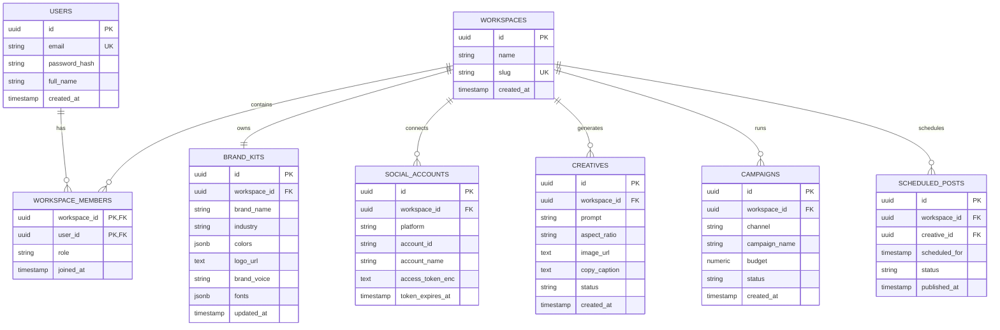

# DOC-006: Database Schema & Entity Relationships

```yaml
id: DOC-006
type: Database-Schema-Specification
status: Accepted
domain: Persistence, PostgreSQL DDL, Multi-Tenant Data Modeling
revision: 1.0
last_updated: 2026-11-24
dependencies: [DOC-002, DOC-005]
```

---

## 1. Entity-Relationship Diagram (ERD)



---

## 2. Production PostgreSQL DDL Script

```sql
-- Enable UUID extension
CREATE EXTENSION IF NOT EXISTS "pgcrypto";

-- 1. Users Table
CREATE TABLE users (
    id UUID PRIMARY KEY DEFAULT gen_random_uuid(),
    email VARCHAR(255) NOT NULL UNIQUE,
    password_hash TEXT NOT NULL,
    full_name VARCHAR(150) NOT NULL,
    created_at TIMESTAMPTZ NOT NULL DEFAULT NOW(),
    updated_at TIMESTAMPTZ NOT NULL DEFAULT NOW()
);

-- 2. Workspaces Table (Tenant Boundary)
CREATE TABLE workspaces (
    id UUID PRIMARY KEY DEFAULT gen_random_uuid(),
    name VARCHAR(255) NOT NULL,
    slug VARCHAR(100) NOT NULL UNIQUE,
    created_at TIMESTAMPTZ NOT NULL DEFAULT NOW(),
    updated_at TIMESTAMPTZ NOT NULL DEFAULT NOW()
);

-- 3. Workspace Memberships (Role-Based Access)
CREATE TABLE workspace_members (
    workspace_id UUID NOT NULL REFERENCES workspaces(id) ON DELETE CASCADE,
    user_id UUID NOT NULL REFERENCES users(id) ON DELETE CASCADE,
    role VARCHAR(50) NOT NULL DEFAULT 'member' CHECK (role IN ('owner', 'admin', 'member')),
    joined_at TIMESTAMPTZ NOT NULL DEFAULT NOW(),
    PRIMARY KEY (workspace_id, user_id)
);
CREATE INDEX idx_workspace_members_user ON workspace_members(user_id);

-- 4. Brand Kits (Creative Identity)
CREATE TABLE brand_kits (
    id UUID PRIMARY KEY DEFAULT gen_random_uuid(),
    workspace_id UUID NOT NULL UNIQUE REFERENCES workspaces(id) ON DELETE CASCADE,
    brand_name VARCHAR(255) NOT NULL,
    industry VARCHAR(100) NOT NULL DEFAULT 'General',
    colors JSONB NOT NULL DEFAULT '{"primary": "#000000", "secondary": "#ffffff", "accent": "#f59e0b"}'::jsonb,
    logo_url TEXT,
    brand_voice VARCHAR(100) NOT NULL DEFAULT 'Professional',
    fonts JSONB DEFAULT '{"heading": "Inter", "body": "Inter"}'::jsonb,
    created_at TIMESTAMPTZ NOT NULL DEFAULT NOW(),
    updated_at TIMESTAMPTZ NOT NULL DEFAULT NOW()
);
CREATE INDEX idx_brand_kits_workspace ON brand_kits(workspace_id);

-- 5. Connected Social & Ad Accounts (Encrypted OAuth Tokens)
CREATE TABLE social_accounts (
    id UUID PRIMARY KEY DEFAULT gen_random_uuid(),
    workspace_id UUID NOT NULL REFERENCES workspaces(id) ON DELETE CASCADE,
    platform VARCHAR(50) NOT NULL CHECK (platform IN ('meta', 'instagram', 'google_ads', 'whatsapp')),
    account_id VARCHAR(255) NOT NULL,
    account_name VARCHAR(255) NOT NULL,
    access_token_enc TEXT NOT NULL,
    refresh_token_enc TEXT,
    token_expires_at TIMESTAMPTZ,
    connected_at TIMESTAMPTZ NOT NULL DEFAULT NOW(),
    UNIQUE(workspace_id, platform, account_id)
);
CREATE INDEX idx_social_accounts_workspace ON social_accounts(workspace_id);

-- 6. Generated Creatives (Posters, Copy, Banners)
CREATE TABLE creatives (
    id UUID PRIMARY KEY DEFAULT gen_random_uuid(),
    workspace_id UUID NOT NULL REFERENCES workspaces(id) ON DELETE CASCADE,
    prompt TEXT NOT NULL,
    aspect_ratio VARCHAR(20) NOT NULL DEFAULT '1:1' CHECK (aspect_ratio IN ('1:1', '4:5', '9:16', '16:9')),
    image_url TEXT NOT NULL,
    copy_caption TEXT,
    tags TEXT[],
    status VARCHAR(50) NOT NULL DEFAULT 'ready' CHECK (status IN ('generating', 'ready', 'failed')),
    created_at TIMESTAMPTZ NOT NULL DEFAULT NOW()
);
CREATE INDEX idx_creatives_workspace ON creatives(workspace_id);

-- 7. Scheduled Social Posts (Organic Calendar)
CREATE TABLE scheduled_posts (
    id UUID PRIMARY KEY DEFAULT gen_random_uuid(),
    workspace_id UUID NOT NULL REFERENCES workspaces(id) ON DELETE CASCADE,
    creative_id UUID NOT NULL REFERENCES creatives(id) ON DELETE RESTRICT,
    platforms VARCHAR(50)[] NOT NULL,
    scheduled_for TIMESTAMPTZ NOT NULL,
    status VARCHAR(50) NOT NULL DEFAULT 'scheduled' CHECK (status IN ('scheduled', 'publishing', 'published', 'failed')),
    published_at TIMESTAMPTZ,
    error_log TEXT,
    created_at TIMESTAMPTZ NOT NULL DEFAULT NOW()
);
CREATE INDEX idx_scheduled_posts_workspace ON scheduled_posts(workspace_id, scheduled_for);

-- 8. Ad Campaigns (Paid Performance)
CREATE TABLE campaigns (
    id UUID PRIMARY KEY DEFAULT gen_random_uuid(),
    workspace_id UUID NOT NULL REFERENCES workspaces(id) ON DELETE CASCADE,
    channel VARCHAR(50) NOT NULL CHECK (channel IN ('meta', 'google', 'whatsapp')),
    external_campaign_id VARCHAR(255),
    campaign_name VARCHAR(255) NOT NULL,
    daily_budget NUMERIC(12, 2) NOT NULL,
    status VARCHAR(50) NOT NULL DEFAULT 'draft' CHECK (status IN ('draft', 'active', 'paused', 'completed')),
    metrics JSONB DEFAULT '{"spend": 0, "impressions": 0, "clicks": 0, "leads": 0}'::jsonb,
    created_at TIMESTAMPTZ NOT NULL DEFAULT NOW(),
    updated_at TIMESTAMPTZ NOT NULL DEFAULT NOW()
);
CREATE INDEX idx_campaigns_workspace ON campaigns(workspace_id);
```
