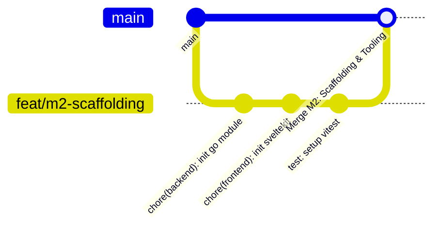

# DOC-008: Git Branching & Conventional Commit Workflow

```yaml
id: DOC-008
type: Process-Specification
status: Accepted
domain: Version Control, Branching Strategy, Commit Standards
revision: 1.0
last_updated: 2026-11-24
dependencies: [DOC-007]
```

---

## 1. Branching Model: Feature-Scoped Branching

All feature development occurs on dedicated feature branches cut from `main`.



### Branch Naming Conventions
- `feat/<milestone-or-domain>` (e.g. `feat/m2-scaffolding`, `feat/auth-workspaces`, `feat/brand-kit`)
- `fix/<issue-name>` (e.g. `fix/jwt-expiration`, `fix/color-picker-contrast`)
- `docs/<doc-name>` (e.g. `docs/api-contracts`)

---

## 2. Commit Message Standard: Conventional Commits

Every commit on a feature branch must follow the Conventional Commits specification:

```
<type>(<scope>): <short imperative description>
```

### Allowed Types
- `feat`: A new feature or capability.
- `fix`: A bug fix or correction.
- `test`: Adding, updating, or fixing unit/integration tests.
- `docs`: Documentation updates.
- `chore`: Tooling, build config, dependency updates.
- `refactor`: Restructuring code without changing external behavior.

### Allowed Scopes
`backend`, `frontend`, `auth`, `workspace`, `brandkit`, `creatives`, `campaigns`, `contracts`, `docs`

---

## 3. Definition of Done (Before Merging to `main`)
1. All unit tests must pass (`go test ./...` and `npm run test`).
2. Contract synchronization verified (`openapi.yaml` matches frontend types).
3. Security review passes (no `workspace_id` tenant isolation leaks).
4. Code review approval from `code-reviewer` agent.
