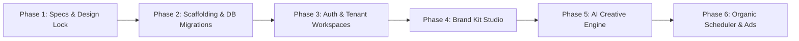

# DOC-007: Work Breakdown Structure (WBS) & Milestones

```yaml
id: DOC-007
type: Milestone-WBS-Specification
status: Active
domain: Project Management, Execution Order, Task Breakdown
revision: 1.0
last_updated: 2026-11-24
dependencies: [DOC-001, DOC-002, DOC-003, DOC-004, DOC-005, DOC-006]
```

---

## 1. Master Execution Work Order

To ensure zero rework and strict adherence to invariants, tasks must be executed in this exact sequence:



---

## 2. Granular Task Breakdown by Milestone

### Milestone 1: Specifications, Theme & Architecture (CURRENT)
- [x] **TASK-1.1**: Define technology stack rationale & trade-offs ([DOC-001](file:///Users/manoranjan/Projects/Learning/digital-marketing-assistant/docs/tech_stack_decision.md)).
- [x] **TASK-1.2**: Define backend architecture, state management & invariants ([DOC-002](file:///Users/manoranjan/Projects/Learning/digital-marketing-assistant/docs/architecture_decisions.md)).
- [x] **TASK-1.3**: Establish Topological Knowledge Graph & Graphify Registry ([DOC-003](file:///Users/manoranjan/Projects/Learning/digital-marketing-assistant/docs/GRAPH.md)).
- [x] **TASK-1.4**: Define UI/UX Design System, Theme Tokens & Typography ([DOC-004](file:///Users/manoranjan/Projects/Learning/digital-marketing-assistant/docs/ui_ux_design_system.md)).
- [x] **TASK-1.5**: Author High-Level (HLD) & Low-Level Design (LLD) ([DOC-005](file:///Users/manoranjan/Projects/Learning/digital-marketing-assistant/docs/system_design_hld_lld.md)).
- [x] **TASK-1.6**: Design complete PostgreSQL DDL Schema with constraints ([DOC-006](file:///Users/manoranjan/Projects/Learning/digital-marketing-assistant/docs/database_schema.md)).
- [x] **TASK-1.7**: Establish 7-member Specialized Agent Team & Day-1 Testing Invariant ([AGENTS.md](file:///Users/manoranjan/Projects/Learning/digital-marketing-assistant/AGENTS.md)).

---

### Milestone 2: Scaffolding, Tooling & Database Migrations (COMPLETE)
- [x] **TASK-2.1**: Initialize Go 1.25+ module in `backend/` with standard layout (`cmd/server/main.go`, `internal/platform/`).
- [x] **TASK-2.2**: Set up `sqlc.yaml` and copy initial DDL schema into `backend/sql/schema/001_initial_schema.sql`.
- [x] **TASK-2.3**: Initialize SvelteKit (Svelte 5) project in `frontend/` with Tailwind CSS, Lucide icons, and design tokens from DOC-004.
- [x] **TASK-2.4**: Configure Vitest for frontend unit tests and verify `npm run test` executes cleanly.
- [x] **TASK-2.5**: Set up `api-spec/openapi.yaml` and configure `npm run codegen` (`openapi-typescript`).
- [x] **TASK-2.6**: Configure local PostgreSQL runner (`docker-compose.yml`) and verify DB connection with `pgxpool`.

---

### Milestone 3: Authentication & Multi-Tenant Workspaces (End-to-End)
- [x] **TASK-3.1**: Implement `backend/internal/auth` (User registration, login, bcrypt/Argon2id, JWT generation) + unit tests in `auth/service_test.go`.
- [x] **TASK-3.2**: Implement `backend/internal/workspace` (Create workspace, list user workspaces, membership RBAC) + unit tests.
- [x] **TASK-3.3**: Implement JWT Auth & Workspace Guard Middleware (`internal/platform/middleware/`).
- [x] **TASK-3.4**: Implement Svelte 5 Auth Store (`frontend/src/lib/stores/auth.svelte.ts`) + unit tests in `auth.test.ts`.
- [x] **TASK-3.5**: Implement Svelte 5 Workspace Store (`frontend/src/lib/stores/workspace.svelte.ts`) + unit tests.
- [x] **TASK-3.6**: Build Login, Register, and Workspace Switcher UI widgets adhering to DOC-004 tokens.
- [ ] **TASK-3.7**: Run security audit (`security_analyst`) and code review (`code_reviewer`) before commit.

---

### Milestone 4: Brand Kit Studio & Asset Management
- [ ] **TASK-4.1**: Implement `backend/internal/brandkit` (Get, Upsert Brand Kit) + unit tests with mock repo.
- [ ] **TASK-4.2**: Implement `frontend/src/lib/stores/brand-kit.svelte.ts` + unit tests in `brand-kit.test.ts`.
- [ ] **TASK-4.3**: Build UI widgets: `PaletteEditor.svelte`, `LogoUploader.svelte`, `VoiceSelector.svelte`.
- [ ] **TASK-4.4**: Assemble Brand Kit management view in `routes/(dashboard)/[workspaceId]/brand-kit/+page.svelte`.
- [ ] **TASK-4.5**: Run QA contract test & security tenant verification.

---

### Milestone 5: AI Creative Engine (Festival/Daily Posters & Copy)
- [ ] **TASK-5.1**: Implement AI Prompt & Vision Service in Go (calling Gemini/Ideogram API with brand colors, logo, and copy).
- [ ] **TASK-5.2**: Image compositing worker (overlaying brand vector logo and promotional text onto background).
- [ ] **TASK-5.3**: Creatives repository & API routes (`/api/v1/workspaces/{id}/creatives`).
- [ ] **TASK-5.4**: Svelte 5 Creative Studio UI: Festival/Event presets (Diwali, New Year, Sale), preview canvas, multi-aspect ratio export (1:1, 9:16).
- [ ] **TASK-5.5**: Unit tests and end-to-end integration tests.

---

### Milestone 6: Organic Social Scheduler & Paid Ad Launcher
- [ ] **TASK-6.1**: Meta OAuth integration (Instagram & Facebook Pages connect flow).
- [ ] **TASK-6.2**: Background scheduler worker in Go (polling `scheduled_posts` via goroutines).
- [ ] **TASK-6.3**: Meta Marketing API integration for Paid Ads (Click-to-WhatsApp and Lead Generation).
- [ ] **TASK-6.4**: SvelteKit Social Calendar View (`routes/(dashboard)/[workspaceId]/calendar/+page.svelte`).
- [ ] **TASK-6.5**: Full regression test suite execution and final code review.
