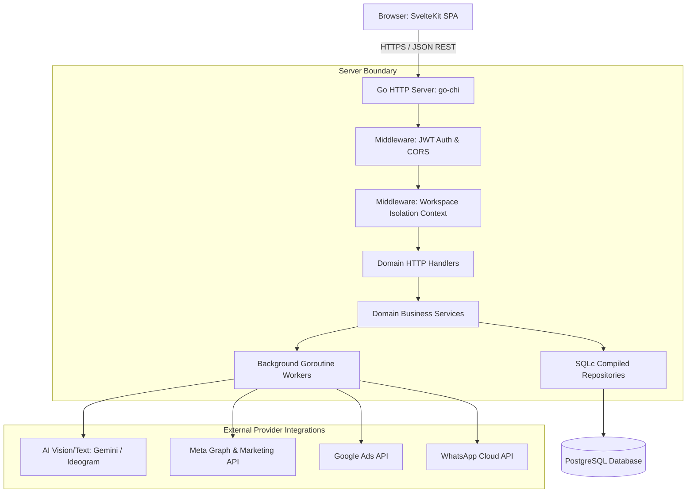

# DOC-005: High-Level Design (HLD) & Low-Level Design (LLD)

```yaml
id: DOC-005
type: System-Design-Specification
status: Accepted
domain: Architecture, Network Topology, Package Design
revision: 1.0
last_updated: 2026-11-24
dependencies: [DOC-001, DOC-002, DOC-003, DOC-004]
```

---

## 1. High-Level Design (HLD)

### 1.1 Global System Topology



### 1.2 Multi-Tenant Request Lifecycle & Security Boundary
1. **Request Ingestion:** The client sends an HTTP request with:
   - `Authorization: Bearer <jwt_token>`
   - `X-Workspace-ID: <uuid>` (or URL parameter `/{workspaceId}/...`)
2. **Auth Middleware (`internal/platform/middleware/auth.go`):**
   - Decodes and verifies JWT signature with `HMAC-SHA256`.
   - Extracts `user_id` and binds it to `r.Context()`.
3. **Tenant Guard Middleware (`internal/platform/middleware/tenant.go`):**
   - Validates that `user_id` is an active member of `workspace_id` in `workspace_members`.
   - Injects validated `workspace_id` and `role` (`owner`, `admin`, `member`) into `r.Context()`.
   - Rejects unauthorized cross-tenant requests with `403 Forbidden`.
4. **Service Execution:** All repository queries receive `ctx` containing the enforced `workspace_id`. Cross-tenant data leakage is structurally impossible.

---

## 2. Low-Level Design (LLD)

### 2.1 Backend Package Internals (Go)

#### A. Domain Module Layout (e.g. `internal/brandkit/`)
- `handler.go`: Decodes JSON HTTP requests, calls service methods, writes standard JSON responses.
- `service.go`: Executes business logic (validating color hex formats, checking logo dimensions, building prompt parameters).
- `repository.go`: Defines the `Repository` interface and delegates to the `sqlc` compiled queries.
- `service_test.go`: Unit tests for business logic using a mock repository.

#### B. Standard API Response Envelope
All HTTP responses adhere to a uniform structure:
```json
// Success Response
{
  "success": true,
  "data": { ... }
}

// Error Response
{
  "success": false,
  "error": {
    "code": "VALIDATION_FAILED",
    "message": "Invalid hex color format for primaryColor"
  }
}
```

### 2.2 Frontend Architecture (SvelteKit)

#### A. Route Tree
```
src/routes/
├── +layout.svelte              # Root shell (theme provider, toast container)
├── (auth)/
│   ├── login/+page.svelte      # Sign in view
│   └── register/+page.svelte   # Registration view
└── (dashboard)/
    └── [workspaceId]/
        ├── +layout.svelte      # App shell (Sidebar, Topbar with WorkspaceSwitcher)
        ├── overview/+page.svelte
        ├── brand-kit/+page.svelte
        ├── campaigns/+page.svelte
        └── calendar/+page.svelte
```

#### B. Store State Machine (Svelte 5 Runes)
Every domain has one dedicated `.svelte.ts` store implementing:
- `$state` reactive fields (data, loading, error).
- Async actions that invoke the typed API client.
- Zero DOM manipulation or HTML markup.
